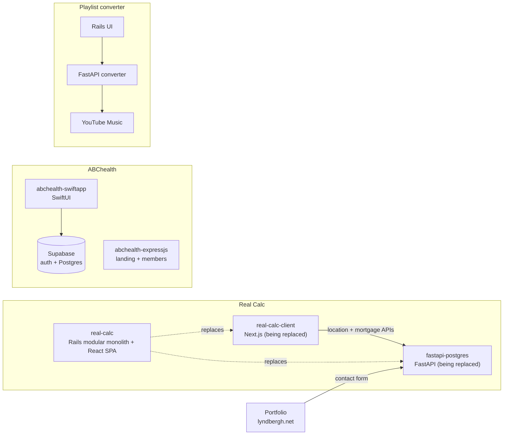
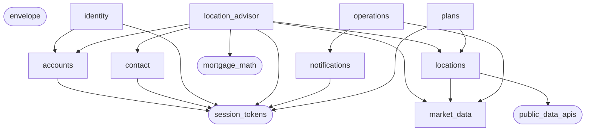

# Lyndbergh Platform

My projects in one place, plus the small Rails app behind them: it monitors every site and holds the endpoints they share.

- **[Projects](#projects):** a walkthrough of each project: what it does, how it's built, the decisions and trade-offs, and the questions I'd expect about it.
- **[Platform app](#platform-app):** this repo's Rails app: the site monitor, plus the contact form and feedback endpoints every site shares.

<!-- walkthrough:start -->

## Projects

A walkthrough of what I've built: what each project does, how it's put together, and the decisions behind it. Most repos are private, so this page is the tour; ask me for access to any of them.

| Project | What it is | Links |
|---|---|---|
| [real-calc](#real-calc) | Real Calc helps home buyers answer two questions: what can I afford, and where should I look. | [repo (private)](https://github.com/Lsimelus/real-calc) · [live](https://realcalc.lyndbergh.net) |
| [abchealth-swiftapp](#abchealth-swiftapp) | ABChealth is a supportive wellness-community iOS app: set and track health goals, share your journey in posts, and connect with others, with gentle check-ins instead of pressure. | [repo (private)](https://github.com/Lsimelus/abchealth-swiftapp) |
| [playlist-video-converter](#playlist-video-converter) | Paste an Apple Music playlist link and get back a YouTube Music playlist of the songs' official music videos only. | local only |
| [fastapi-postgres](#fastapi-postgres) | The original Real Calc API: location ranking, geocoding, saved calculations and magic-link email login. | [repo (private)](https://github.com/Lsimelus/fastapi-postgres) |
| [real-calc-client](#real-calc-client) | The Real Calc frontend: a guided questionnaire that computes monthly payment (PITI + PMI) for Conventional, FHA, VA and USDA loans, plus equity, interest and rent-vs-buy charts, and a Location Explorer that ranks real cities within budget with a details view per city. | [repo (private)](https://github.com/Lsimelus/real-calc-client) · [live](https://real-calc-client-blush.vercel.app) |
| [abchealth-expressjs](#abchealth-expressjs) | The ABChealth landing site and members backend: launch sign-up, Google sign-in, a publisher role that can run and review the members email job, and the /privacy and /terms pages the App Store listing points to. | [repo (private)](https://github.com/Lsimelus/abchealth-expressjs) · [live](https://abchealth-expressjs.vercel.app) |
| [Portfolio](#portfolio) | My personal site: about, resume (PDF viewer), project gallery with videos, and a contact form that posts to my FastAPI backend and stores messages in Postgres. | [repo](https://github.com/Lsimelus/Portfolio) · [live](https://www.lyndbergh.net) |
| [lyndbergh-platform](#lyndbergh-platform) | A small Rails 8 app that checks every one of my sites every five minutes and shows uptime, latency and history next to each repo's CI and Dependabot links. | [repo](https://github.com/Lsimelus/lyndbergh-platform) |

### How they connect



## Featured

### real-calc

*2026-11 → now · Solo engineer: architecture, backend, frontend, infra* · [repo (private)](https://github.com/Lsimelus/real-calc) · [live](https://realcalc.lyndbergh.net)

**Status:** Built and tested. 2026-11-12: AWS stack applied (57 resources) in the management account as a stopgap; HTTPS live at https://realcalc.lyndbergh.net, but AWS blocks ECS for the account, so no container runs yet. Decided 2026-11-13 to stay on AWS and wait for Support to lift the block (a VPS + Kamal + Neon setup was built, then dropped). AI advisor built, off for now.

> Real Calc helps home buyers answer two questions: what can I afford, and where should I look. It's a mortgage calculator plus a location explorer that ranks US cities 0–100 on ten factors (affordability, growth, rental yield, tax, crime, disaster risk and more) using Zillow, FRED, FEMA, FBI and Census data. I rebuilt it from a FastAPI backend plus a Next.js client into one Rails modular monolith that serves the React SPA, and it deploys to AWS (ECS Fargate, RDS) through Terraform and GitHub Actions with OIDC.

**Stack:** Rails 8.1, Ruby 4.0, Packwerk, Grape, Solid Queue, PostgreSQL (RDS), React 19 + Vite, Terraform, AWS ECS Fargate, GitHub Actions (OIDC), Bedrock (planned)

**Architecture.** One Rails 8.1 app, deployed as one container on AWS ECS Fargate with Postgres on RDS. It serves the JSON API, the React frontend and background jobs. The code is split into 13 components whose boundaries Packwerk enforces. Market data from Zillow, Redfin, FHFA, FRED, FEMA, FBI and Census is refreshed monthly by GitHub Actions, and every value records its source.

<details><summary>Component map (13 Packwerk components)</summary>



Arrows point to what a component may call; Packwerk enforces them (no cycles). Rounded boxes are utilities. `envelope` is left out: 9 components use it.

</details>

**Key decisions**

- **Modular monolith with Packwerk instead of microservices (ADR 0001).** The old backend was a 1,800-line main.py plus a 1,800-line csv_utils.py. I wanted clear boundaries without the cost of running several services as a solo developer. *Trade-off:* Boundaries are checked statically, not by the network, so discipline still matters. Splitting out a service later is straightforward because each component already has a public interface.
- **Keep the FastAPI API contract exactly (ADR 0002).** Same paths, status codes and {data, meta, error} envelope, quirks included, so the switch-over is invisible to clients. The Python test suite was ported as request specs to pin the contract down. *Trade-off:* Some odd behaviour stays on purpose (validation failures return 200 with an error envelope).
- **Move market data from CSV files into Postgres (ADR 0004).** FastAPI re-read 25 MB of CSV/JSON on every request, and two files turned out to be wrong (a saved 404 page and a stale copy). Jobs now load the data inside a transaction, reject files under 10 KB and HTML error pages, and precompute factors. *Trade-off:* More moving parts (jobs and a refresh schedule) in exchange for fast, queryable, validated data.
- **Solid Queue inside Puma (ADR 0007).** Emails used to be FastAPI BackgroundTasks, which were lost on restart and never retried. A Postgres-backed queue needs no Redis and runs in the same container. *Trade-off:* Jobs share CPU with web requests. The scale-out plan is a second Fargate service from the same image with SOLID_QUEUE_IN_PUMA=false.
- **AWS Fargate + RDS + Terraform, deploys through GitHub OIDC (ADR 0008).** Managed containers, everything in code, and no long-lived AWS keys in GitHub. *Trade-off:* Costs more and takes more setup than Vercel, but it is real production infrastructure I can reason about.
- **Do the calculator math on the server (ADR 0011).** The planned AI advisor tools need the same math as the calculator. Porting it found two frontend bugs, including property tax under-stated by about 30%. *Trade-off:* The math now has to stay in sync between client and server.
- **Google is the only sign-in (ADR 0012).** One familiar way in, no email provider just for codes. Sign-in gates the advisor, saving your plan and feedback; everything else stays open. *Trade-off:* People without a Google account can't sign in; CSP and OAuth setup needed care (form-action had to allow accounts.google.com).
- **One AWS account per app under Organizations + Identity Center.** Contained blast radius, per-app costs, clean teardown; short-lived credentials with MFA instead of IAM users or root. *Trade-off:* More setup up front, and new organizations start with a low account quota.
- **Fill data gaps from city/county data, and record the source.** Zillow metro files covered only ~47% of places; town/county Zillow and FHFA data lifted growth to 92% and rent to 66%. data_basis says where each value came from. *Trade-off:* Scores no longer match the old Python app for places that had no data, so the parity check was retired.
- **Tests can never call a model.** In the test environment Bedrock points at a .invalid host with fake credentials, WebMock blocks the network, and any request to AWS or Anthropic fails the spec. *Trade-off:* The eval suite that calls the real model has to be a separate, deliberate run.
- **Stopgap: deploy into the Organization's management account.** The Organizations account quota is 1, so the real-calc member account can't be created yet. The Terraform reads the account from the caller, so only the profile changed. On 2026-11-18 AWS declined to raise it (limited usage history), so the stopgap stays until I can re-request. *Trade-off:* Breaks my own one-account-per-app rule: SCPs don't apply to the management account, and moving later means an RDS snapshot copy, new cert and DNS swap.
- **Stay on AWS instead of a $6 VPS (2026-11-13).** I priced the alternatives (AWS ~$65-70/month, VPS + Kamal + Neon ~$6-12, Vercel split) and built the VPS setup, then chose AWS for production-grade infrastructure and the hands-on experience employers ask for. *Trade-off:* About $60 a month more with no users yet, plus account friction (quota, ECS block).
- **Trust GitHub's immutable OIDC subject.** The repo's tokens say repo:Lsimelus@45671470/real-calc@1442215665:..., so trust policies match owner and repo IDs. A renamed or re-created repo can't assume the roles. *Trade-off:* The subject is less readable; the variable documents how to look it up with gh api.

**Numbers**

- 12 Packwerk components (+ plans), 0 dependency cycles
- 33 spec files (121 examples) + 139 frontend tests; tests can never call a model
- 12 ADRs
- Data coverage after gap filling: growth 47% → 92%, rent 47% → 66% of 29,717 places
- 25 MB of CSV per request → Postgres tables, refreshed monthly by GitHub Actions
- AI advisor: 15 read-only tools (4 admin-only), per-user token budgets, 20 turns/hour
- Deploy: CI → ECR → migrate as a one-off task → rolling ECS update with /health check
- Production data measured 2026-11-13: 570 MB right after the load, 211 MB after VACUUM FULL (Neon free cap 0.5 GB)
- Hosting cost compared: AWS ~$65-70/month running (~$27 idle) vs VPS + Neon ~$6-12

**Hard parts**

- Rebuilding without changing user-visible behaviour: contract specs plus a parity task against recorded Python outputs.
- Bad data in production: a saved 404 page was being served as a dataset. Fixed with validation on load and transactional refreshes.
- macOS libpq GSSAPI isn't fork-safe, and Solid Queue forks, so boot.rb sets PGGSSENCMODE=disable.
- First deploy: every GitHub OIDC login was denied. CloudTrail showed the real token subject used immutable IDs (owner@id/repo@id), not owner/repo; changed the trust policies and applied.
- AWS returned BlockedException ('Your account is currently blocked') for every ECS RunTask and service placement while RDS, ALB, ECR and ACM all worked. Only AWS Support can lift it; I stopped RDS to cut idle cost and re-planned hosting.
- Re-running a deploy failed at docker push because ECR tags are immutable; the workflow now skips the build when the commit's image already exists (ecr:BatchGetImage, no new IAM).
- The CI Terraform plan step had been failing silently: the plan role couldn't write the S3 lock file, and '| tee' hid the exit code.

<details><summary>Likely questions</summary>

**Why not microservices?**  
One developer, one domain, low traffic. A modular monolith gives me boundaries (Packwerk) and one thing to deploy, monitor and roll back. Each component already has a public interface, so extracting one later is mechanical.

**How do you deploy and roll back?**  
Merging to main runs CI, builds the image, tags it with the commit SHA, runs migrations as a one-off ECS task, then does a rolling update with an ALB health check. To roll back I point the service at the previous task definition. Migrations are additive by convention, so the old image keeps working.

**How did you make sure the rewrite didn't break anything?**  
I froze the contract with request specs ported from the Python suite and checked the ranking engine against recorded outputs (21/21). The cutover plan is to rehearse the data port against Neon first, then run it for real just before switching DNS.

**How would you scale it?**  
Fargate scales the web tier horizontally. Jobs can move to their own service from the same image. Per-city factors are already precomputed, and read-heavy endpoints could be cached. RDS is the next limit, and read replicas would come before anything fancier.

**Why not Vercel?**  
Vercel runs front ends and short serverless functions. Real Calc is a Rails monolith with background jobs and a ten-minute monthly refresh, so I'd have had to split the app and still host Rails somewhere else.

**Isn't AWS overkill for an app with no users?**  
On cost alone, yes: a $6 VPS with Kamal and Neon runs the same image, and I built that setup as a fallback. I chose AWS because I wanted production-grade infrastructure in code, OIDC deploys with no stored keys, and room to add Bedrock for the advisor, and I accepted about $60 a month for it.

</details>

**Future iterations:** Get AWS Support to lift the ECS block, start RDS, deploy and run the first data load; Turn on the advisor (Bedrock) and run the eval suite; Redfin and HUD data to fill the remaining metro-only gaps; Runbook drills: restore the database from a snapshot

### abchealth-swiftapp

*2025-11 → now · Engineer for a two-founder wellness startup* · [repo (private)](https://github.com/Lsimelus/abchealth-swiftapp)

**Status:** Pre-launch: prod Supabase by 2026-12-31, App Store launch planned 2027-02-08

> ABChealth is a supportive wellness-community iOS app: set and track health goals, share your journey in posts, and connect with others, with gentle check-ins instead of pressure. I'm building the SwiftUI app on Supabase (auth and Postgres) and the schema behind it, including the safety features the App Store requires for user-generated content.

**Stack:** Swift 5.9, SwiftUI, iOS 26 (iPhone only), MVVM, Supabase Swift SDK 2.37, PostgreSQL, TestFlight (planned), Sentry (planned)

**Architecture.** Feature modules (Goals, Home, Social, Sharing, Search, Create, Activity, Profile, Authentication), each split into Views / ViewModels / Services / Models, with a shared Supabase client. The database is 8 ordered SQL files: users and goals, social, content and news, sharing, notifications, and safety (reports, blocks, account deletion), with row-level security policies. Community features sit behind an AppConfiguration flag.

**Key decisions**

- **Supabase instead of a custom backend.** Auth, Postgres, storage and realtime with no servers to run, for a small team. *Trade-off:* Vendor lock-in, and security lives in RLS policies that have to be right.
- **Community features behind a flag.** Lets us launch private-first and turn social on once moderation is ready (launch options A/B/C). *Trade-off:* Two code paths to test.
- **Safety schema applied last and required.** Apple requires report, block and account-deletion features for apps with user-generated content. It also fixes a trigger that crossed between users. *Trade-off:* Adds to the launch scope.

**Numbers**

- 49 Swift files
- 8 SQL schema files, 6 with RLS policies
- Launch plan: Apple account from 2027-01-01, submit 2027-02-02

**Hard parts**

- A duplicate UserProfile model broke the build; fixed by keeping one canonical definition.
- Ordering 8 schema migrations; checked against Postgres 18 with a stubbed auth schema.

<details><summary>Likely questions</summary>

**How do you secure user data with Supabase?**  
Row-level security on every user table, so the client can only read or write its own rows, plus explicit report, block and deletion flows. The anon key is public by design. The policies are the real security boundary.

**How are you de-risking the launch?**  
Production Supabase and auth go live first, with a full simulator test against prod. Then TestFlight, crash reporting and unit tests on the date decoder and GoalsViewModel before submitting.

</details>

**Future iterations:** Sentry plus a unit test target (planned by 2026-11-15); CI for xcodebuild

### playlist-video-converter

*2026 → now · Solo* · local only

**Status:** Building, due 2027-01-31

> Paste an Apple Music playlist link and get back a YouTube Music playlist of the songs' official music videos only. No lyric videos, audio uploads, covers or live versions, and no repeats. Songs without an official video are listed instead of being matched badly.

**Stack:** Python, FastAPI, ytmusicapi, rapidfuzz, httpx, pydantic, diskcache, Google OAuth (device flow), pytest

**Architecture.** Reads the public Apple Music page's embedded JSON (no Apple API key needed) → searches YouTube Music 4 songs at a time → scores each candidate → removes duplicates → creates a private playlist through OAuth. Accepted matches are cached for 30 days. A web UI (server.py on localhost) and a CLI share the same engine.

**Key decisions**

- **A scoring model with hard caps instead of 'take the top result'.** Points for title similarity (45), artist match (25/18), official video (20), duration (10) and views (5), minus penalties for remix, live and so on. Anything that isn't an official video is capped below the 55-point threshold. *Trade-off:* Precision over recall: some songs are left out, by design.
- **Scrape the public page instead of the Apple Music API.** No developer token needed. *Trade-off:* Limited to the first 300 tracks, and it breaks if Apple changes its markup.

**Numbers**

- ~45 s for 300 songs
- Acceptance threshold 55/100
- Tests: Apple Music parser and matcher

**Hard parts**

- Apple masks explicit titles (e.g. 'P***y is Mine'), so matching had to handle masked titles.
- A 300-song playlist in about 45 s with 4 searches running at once and no API quota.

<details><summary>Likely questions</summary>

**How do you test a fuzzy matcher?**  
Fixed cases for the tricky ones (masked titles, remixes, lyric videos, artist-channel 'Official Video'), with the score breakdown saved in -o results.json so I can see why a match was accepted or rejected.

</details>

**Future iterations:** git init and push, then CI; A golden set of playlists to measure precision and recall

## Supporting

### fastapi-postgres

*2025-10 → 2026-09 · Solo backend engineer* · [repo (private)](https://github.com/Lsimelus/fastapi-postgres)

**Status:** Being replaced by real-calc (archive after cutover)

> The original Real Calc API: location ranking, geocoding, saved calculations and magic-link email login. It also handled the contact form for my portfolio. It combined Zillow CSVs, a county-to-metro crosswalk, FBI crime data and FEMA risk data into one weighted match score per city.

**Stack:** Python, FastAPI, SQLAlchemy, Pydantic, PostgreSQL (Neon), pandas, Resend, PyJWT, slowapi, pytest, Vercel

**Architecture.** main.py (FastAPI routes) → csv_utils.py (ranking plus CSV/JSON lookups) and external_apis.py (live Census, BLS and FEMA calls). Cities come from Postgres. For each one: find its Zillow metro (directly or through the county crosswalk), read its factors, min-max normalize across the candidate pool, then combine with user-weighted priorities. Each response marks which factors had data, so the UI can show N/A instead of a made-up number.

**Key decisions**

- **Report missing data per factor (score_data_available) instead of filling it in.** A made-up 50% looks real to a user. Being honest about gaps builds trust. *Trade-off:* The frontend has more cases to handle.
- **Rate limiting with slowapi and an email whitelist.** Protects the free-tier email quota and the API from abuse. *Trade-off:* Limits are per process on serverless, so they're only approximate.

**Numbers**

- About 117 pytest tests across 7 files
- main.py 1,810 lines, csv_utils.py 1,780 lines

**Hard parts**

- Matching cities to Zillow metros when a town isn't a named metro: solved with a county → CBSA crosswalk.
- The two 1,800-line modules became hard to change, which is what led to the Rails rebuild.

<details><summary>Likely questions</summary>

**What would you do differently?**  
Load data through a pipeline into tables from day one instead of reading files on every request, and split modules by domain early. I did both in the Rails rebuild.

**How does the ranking work?**  
Min-max normalize each of the ten factors across the cities that pass the budget filter, apply default weights plus up to two user priorities, and sum to a 0–100 score. Missing factors are flagged, not filled in.

</details>

**Future iterations:** Superseded by real-calc

### real-calc-client

*2024-04 → 2026-09 · Main contributor (168 commits)* · [repo (private)](https://github.com/Lsimelus/real-calc-client) · [live](https://real-calc-client-blush.vercel.app)

**Status:** Live on Vercel; being replaced by the SPA inside real-calc

> The Real Calc frontend: a guided questionnaire that computes monthly payment (PITI + PMI) for Conventional, FHA, VA and USDA loans, plus equity, interest and rent-vs-buy charts, and a Location Explorer that ranks real cities within budget with a details view per city.

**Stack:** Next.js 15, React 19 (React Compiler), TypeScript, Redux Toolkit, Tailwind, shadcn/ui (Radix), Recharts, Jest, Playwright

**Architecture.** Redux slices (userInput / location / progress) drive the summary card and charts. All payment and amortization math runs in the browser. Only the Location Explorer and city details call the API.

**Key decisions**

- **Do the math on the client.** Instant feedback and no server cost. *Trade-off:* Later the AI advisor needed the same math on the server, and porting it found a ~30% property-tax bug (see real-calc ADR 0011).
- **Next.js → plain React SPA in the rebuild.** The app used almost nothing server-side from Next (one page, metadata, fonts). *Trade-off:* No server-side rendering, which this app doesn't need.

**Numbers**

- 168 commits
- Jest unit tests plus Playwright end-to-end tests

**Hard parts**

- Keeping a long questionnaire's state consistent: Redux slices plus a progress slice.

<details><summary>Likely questions</summary>

**Why Redux here?**  
Many questionnaire steps feed several charts at once. One store with typed slices made the data flow easy to follow and test.

</details>

**Future iterations:** Superseded by gems/real_calc_web in real-calc

### abchealth-expressjs

*2025-11 → 2026-09 · Engineer* · [repo (private)](https://github.com/Lsimelus/abchealth-expressjs) · [live](https://abchealth-expressjs.vercel.app)

**Status:** Live

> The ABChealth landing site and members backend: launch sign-up, Google sign-in, a publisher role that can run and review the members email job, and the /privacy and /terms pages the App Store listing points to.

**Stack:** Node.js, Express 4, Passport (Google OAuth 2.0), PostgreSQL, connect-pg-simple sessions, node-cron, Tailwind, Jest + supertest, Vercel

**Architecture.** Express serves static pages and JSON routes. Sessions are stored in Postgres (30-day httpOnly cookies, secure in production). A requireRole middleware returns 401 vs 403 correctly. A daily cron job logs a row per run to abc_email_jobs, and publishers can also trigger it by hand. Referrer capture records where sign-ups come from.

**Key decisions**

- **Sessions in Postgres instead of JWT.** Revocable, simple, and it reuses the database we already have. *Trade-off:* One database read per request.
- **Stub the email job but build its plumbing first.** Scheduling, the manual trigger and run history can be tested before choosing an email provider. *Trade-off:* No real emails go out yet.

**Numbers**

- 7 test files (auth, roles, email job, legal, referrer, publisher)

**Hard parts**

- Cron on a serverless host: an in-process schedule needs a long-running process, so a platform cron would be the next step.

<details><summary>Likely questions</summary>

**401 or 403?**  
401 means we don't know who you are (sign in). 403 means we know who you are and you're not allowed. requireRole returns each one in the right case, and both are tested.

</details>

**Future iterations:** Logging and uptime checks; Move the cron to Vercel Cron

### Portfolio

*2023-02 → now · Solo* · [repo](https://github.com/Lsimelus/Portfolio) · [live](https://www.lyndbergh.net)

**Status:** Live

> My personal site: about, resume (PDF viewer), project gallery with videos, and a contact form that posts to my FastAPI backend and stores messages in Postgres.

**Stack:** React 18, TypeScript, Create React App, MUI, styled-components, axios, Vercel

**Architecture.** A single-page app with scroll navigation. All content lives in src/data/data.tsx. The contact form POSTs to /api/contact-form on the FastAPI backend.

**Key decisions**

- **Keep content in one data file.** Updating the site means editing one file, not components. *Trade-off:* Not a CMS, so only I can edit it.

**Numbers**

- 67 commits since 2023

**Hard parts**

- The contact backend has moved three times (Render Node → Flask → FastAPI), each time behind the same form.

**Future iterations:** Move off CRA (deprecated) to Vite; Point the contact form at real-calc or a small serverless function after the FastAPI app is retired

### lyndbergh-platform

*Nov 2026 · Solo: design, build, CI* · [repo](https://github.com/Lsimelus/lyndbergh-platform)

**Status:** Built Nov 2026; monitoring works locally, deploy pending

> A small Rails 8 app that checks every one of my sites every five minutes and shows uptime, latency and history next to each repo's CI and Dependabot links. I run sites across Rails, Express, FastAPI and Vercel and had no single place that told me which were up. The first run caught a real bug: my ABCHealth API URL was returning the static HTML page with a 200, so a plain uptime check would have called it healthy. I check that APIs answer in JSON, which caught it. It also holds the endpoints my sites share (the contact form and feedback), and its README is the public walkthrough of all my projects.

**Stack:** Ruby 4, Rails 8, SQLite, Solid Queue, Minitest, GitHub Actions

**Architecture.** Sites are listed in config/sites.yml. A recurring Solid Queue job (CheckSitesJob, every 5 minutes) requests each health URL with 10-second timeouts and stores one Check row: ok, HTTP status, latency, error. Checks older than 30 days are pruned. One status page reads the latest check, 24-hour uptime and the last 48 checks per site. SQLite, no external services. Shared endpoints: POST /api/contact-form and POST /api/feedback, two tables (contact_messages, feedback) under one abstract Submission model, and two controller parents: Api::BaseController (the {data, meta, error} envelope and request logging) and Api::SubmissionsController (rate limiting at 5 per 10 minutes per IP, plus a honeypot field). Every app logs in one shared JSON event format with a per-session id, so a person's path can be followed across sites. A password-protected /forms page lists contact messages with a Reply link and shows feedback by site: average rating, the 1-5 spread and recent comments.

**Key decisions**

- **Sites in YAML, not a table.** Four to eight sites that change rarely; editing a file in a PR is reviewable and needs no admin UI. *Trade-off:* Adding a site needs a deploy.
- **Check for JSON instead of full OpenAPI validation.** I first validated health responses against each service's OpenAPI spec, then cut it: it needed vendored specs, Redocly and codegen for four endpoints. `expect: json` catches the same deploy failure in five lines. *Trade-off:* It won't catch a JSON response with the wrong shape.
- **Rails 8 + SQLite + Solid Queue.** One process, one file database, built-in recurring jobs: nothing extra to host. *Trade-off:* Single server; fine for a personal monitor.
- **Two tables for contact messages and feedback, not one.** I drafted one form_entries table, but almost every rule became 'unless it's feedback'. Contact messages need every field and get a reply; feedback is often anonymous, has a 1-5 rating and is read in bulk. *Trade-off:* Two endpoints and tables instead of one; shared rules live in an abstract Submission model so they aren't duplicated.
- **Shared endpoints live in the platform, not in a product.** Portfolio messages are personal, not Real Calc's, and shouldn't depend on Real Calc's hosting. *Trade-off:* The platform has to stay up for every site's forms, so it needs its own host and backups.

**Numbers**

- Checks every 5 minutes, keeps 30 days of history
- Caught a production misdeploy (HTML served at an API health URL) on the first run

**Hard parts**

- Cutting scope: started as a 'software factory' with shared API contracts, Swift and TypeScript codegen and scaffolders, then trimmed it to the part that had a real user.

<details><summary>Likely questions</summary>

**Why build this instead of using UptimeRobot?**  
A hosted pinger only knows a URL returned 200. Mine knows each site's repo, CI and expected response, so it caught an API that returned 200 with an HTML page. It's also a small, complete Rails 8 app I can talk through end to end.

**What would you add next?**  
Alerts on an up-to-down transition, then moving my Portfolio's contact form backend here so the forms page reads from its own database.

</details>

**Future iterations:** Deploy it on a host separate from real-calc's AWS account (Render recommended), with daily SQLite backups; Move the Portfolio contact form here and retire fastapi-postgres; Feedback buttons on Real Calc and ABChealth; Alert on up-to-down transitions; PR review agents

## Story bank

Behavioral prompts mapped to real moments in these projects.

| Prompt | Project | What happened |
|---|---|---|
| Tell me about a large migration or rewrite | real-calc | FastAPI + Next.js → Rails modular monolith. Risk: changing results users can see. Action: froze the contract with ported request specs and checked ranking parity against recorded Python outputs (21/21). Result: one deployable, 12 enforced components, data in Postgres instead of 25 MB of CSV per request. |
| A bug you found that others missed | real-calc | Porting the calculator math to the server showed property tax was under-stated by about 30% in the frontend: an annual percent was being treated wrongly. I wrote it up in ADR 0011 and fixed it on both sides. |
| A production data incident | real-calc / fastapi-postgres | A saved 404 HTML page was being served as a dataset. I added load-time validation (reject under 10 KB or HTML) and transactional refreshes, so a bad file can never replace good data. |
| A trade-off you made | playlist-video-converter | Precision over recall: the matcher caps anything that isn't an official video below the acceptance threshold, so songs get left out instead of matched wrongly. Users would rather see a short list of correct videos than a padded one. |
| Working with non-technical stakeholders | ABChealth | Two founders, three launch options (open community / circles / private-first). I put community features behind a flag so they can choose late without a rewrite, and laid out the launch plan around Apple's requirements. |
| Security / auth design | abchealth-expressjs / ABChealth | Postgres-backed revocable sessions, httpOnly cookies that are secure in production, requireRole returning 401 vs 403 correctly (with tests), and Supabase RLS on every user table. |
| Tell me about a time you changed direction | real-calc | Built full AWS infra in Terraform and applied it, then hit an account-level ECS block. I priced the alternatives (AWS $65-70, Vercel split, VPS + Neon ~$6), measured the data against Neon's free cap, and built a working Kamal setup as a fallback. Then I made the call to stay on AWS for production-grade infrastructure, with the fallback ready if the block drags on. |
| Debugging something you didn't understand at first | real-calc | GitHub Actions couldn't assume any AWS role. The trust policies looked right, so I went to CloudTrail, which showed the token's actual subject used GitHub's immutable owner/repo IDs. Matched the policy to it, applied, and the next run logged in and pushed the image. |

## Roadmap

What I'm working on now, what's next, and where each project goes from here.

### In progress

- [ ] real-calc v1 live on a Kamal VPS (Hetzner, ~€5-10/month) instead of AWS: create the server, Postgres on it with daily backups, kamal setup, first data load, check /health and sign-in. Keep the Terraform/AWS build as the story (built it, hit an account block, moved to a portable setup) — due Thanksgiving 2026-11-26
- [ ] Add error tracking, structured logs and one alert to real-calc, and fill in its links row — part of real-calc v1, due 2026-11-26
- [ ] Turn on real-calc's location advisor on Bedrock from the VPS (IAM user allowed only InvokeModel on the Claude models, key in Kamal secrets, AWS Budgets alert), then ship its eval suite (golden test set + scored runs) — due 2026-12-31

### Up next

- [ ] Deploy step 1 (me): create a Hetzner CX22 (Ubuntu 24.04, Ashburn) with my SSH key, plus a GitHub token with write:packages for the image registry, and send Claude the IP
- [ ] Deploy step 2: fix real-calc's failing Security CI job (failing nightly since 2026-11-17) before go-live
- [ ] Deploy step 3: restore real-calc's Kamal config from git history, with Postgres on the server (Kamal accessory) and daily backups instead of Neon
- [ ] Deploy step 4: point realcalc.lyndbergh.net at the VPS in Google Cloud DNS (today it points at the AWS load balancer), check /health and sign-in, then tear down the AWS stack to stop the idle bill (~$27/month; keep the Terraform code)
- [ ] Deploy lyndbergh-platform with Kamal on the same VPS as real-calc, with daily SQLite backups and a free healthchecks.io heartbeat so I still hear about it if the server goes down
- [ ] Write a runbook for real-calc on the VPS: deploy (kamal deploy), rollback (kamal rollback), restore Postgres from the daily backup — after real-calc v1 is live
- [ ] Commit the dev-port changes in real-calc, real-calc-client, abchealth-expressjs, fastapi-postgres and Portfolio, and decide whether to keep the two openapi.yaml files
- [ ] Re-date the overdue ABChealth todos (Nov 4/8/15), or keep ABChealth items out of the public README
- [ ] Decide with the founders where the ABChealth landing site lives (Vercel Hobby forbids commercial use; it also needs a long-running server for its cron): Vercel Pro or Render on an account they own. abchealth.lyndbergh.net is fine for a preview; launch on their own domain so the App Store privacy/terms links never change
- [ ] PR-review agents for my repos on the Anthropic API (Managed Agents), with a page on the platform showing what each did — after the advisor's eval ships
- [ ] Move the Portfolio contact form to lyndbergh-platform: copy the contact_forms rows from fastapi-postgres, point REACT_APP_API_URL (Vercel + .env) at it, watch it for a week, then retire fastapi-postgres
- [ ] Add feedback buttons (rate the experience and/or comment) to Real Calc and ABChealth, posting to lyndbergh-platform's /api/feedback
- [ ] ABChealth [pre-Apple]: enroll in the Apple Developer Program and pick the launch option (A open community / B circles / C private-first) (due 2026-11-04)
- [ ] Finish Apple Music → YouTube Music playlist app (playlist-video-converter) — due 2027-01-31
- [ ] ABChealth [pre-Apple]: stand up production Supabase: apply the 8 SQL files, auth redirects + Google provider, full simulator test against prod (due 2026-11-08)
- [ ] ABChealth [pre-Apple]: deploy the landing site with /privacy and /terms live (set CONTACT_EMAIL in Vercel) (due 2026-11-08)
- [ ] ABChealth [pre-Apple]: add Sentry crash reporting + a unit test target for the date decoder and GoalsViewModel (due 2026-11-15)
- [ ] ABChealth [pre-Apple]: write 10-15 evergreen articles, take simulator screenshots, draft listing copy, create the App Review demo account (due 2026-11-15)
- [ ] ABChealth [pre-Apple]: wire or delete the 3 unreachable screens (Create post, Activity, Profile) (due 2026-11-15)
- [ ] ABChealth [post-Apple]: set team + Sign in with Apple, add Supabase Apple provider, upload 1.0 (1) to TestFlight and test on 2 iPhones (due 2026-11-22)
- [ ] ABChealth [post-Apple]: run an external TestFlight beta with 15-30 waitlist users; fix crashes only (Nov 23 - Dec 6)
- [ ] ABChealth [post-Apple]: submit for review Dec 8, launch Dec 14, email the waitlist, watch crash reports for 48h (due 2026-12-14)

### Someday

- [ ] ABChealth launch: upgrade Supabase to Pro ($25/month) before real users (free projects pause after ~a week idle)
- [ ] Re-request the AWS Organizations account quota after ~3 months of steady usage, then move real-calc out of the management account into its own member account (RDS snapshot copy, new cert, DNS swap)

### Recently done

- [x] data:refresh ends with VACUUM ANALYZE so the database stops growing each month (commit 5970785) (2026-11-13)
- [x] Write an ADR for the FastAPI → Rails modular monolith decision (2026-11-08)
- [x] Set up CI, Dependabot and security scanning for real-calc on GitHub Actions — part of real-calc v1, due 2026-11-26 (2026-11-08)
- [x] ABChealth: found and fixed RLS bug: cross-user Postgres triggers (DM threads, like/comment counts, notifications) now SECURITY DEFINER, verified on scratch Postgres (2026-11-01)
- [x] ABChealth: App Store blockers built: account deletion, report/block, privacy manifest, app icon/logo, privacy + terms pages, iPhone-only iOS 26 (2026-11-01)

### Future iterations

| Project | Next iterations |
|---|---|
| [real-calc](#real-calc) | Get AWS Support to lift the ECS block, start RDS, deploy and run the first data load; Turn on the advisor (Bedrock) and run the eval suite; Redfin and HUD data to fill the remaining metro-only gaps; Runbook drills: restore the database from a snapshot |
| [abchealth-swiftapp](#abchealth-swiftapp) | Sentry plus a unit test target (planned by 2026-11-15); CI for xcodebuild |
| [playlist-video-converter](#playlist-video-converter) | git init and push, then CI; A golden set of playlists to measure precision and recall |
| [fastapi-postgres](#fastapi-postgres) | Superseded by real-calc |
| [real-calc-client](#real-calc-client) | Superseded by gems/real_calc_web in real-calc |
| [abchealth-expressjs](#abchealth-expressjs) | Logging and uptime checks; Move the cron to Vercel Cron |
| [Portfolio](#portfolio) | Move off CRA (deprecated) to Vite; Point the contact form at real-calc or a small serverless function after the FastAPI app is retired |
| [lyndbergh-platform](#lyndbergh-platform) | Deploy it on a host separate from real-calc's AWS account (Render recommended), with daily SQLite backups; Move the Portfolio contact form here and retire fastapi-postgres; Feedback buttons on Real Calc and ABChealth; Alert on up-to-down transitions; PR review agents |

## Archive

<details><summary>23 older, school and superseded repos</summary>

| Repo | When | What | Stack |
|---|---|---|---|
| [Marhaban](https://github.com/Lsimelus/Marhaban) | 2025 | Website for a non-profit: news feed from NewsAPI, contact form saved to MongoDB. The backend lived on a separate branch to keep secrets out of the public repo. *Building for a real non-profit client.* | TypeScript, React, Tailwind, Node.js, MongoDB, NewsAPI, Vercel |
| [lyndbergh_net](https://github.com/Lsimelus/lyndbergh_net) | 2025 | A mobile (Expo) version of my personal site. | TypeScript, React Native (Expo) |
| [flask-backend](https://github.com/Lsimelus/flask-backend) | 2025 | The earlier backend for real-calc-client and Portfolio. A script generated a CSV of real-estate data that served as the database. *The step between RenderComAPI and fastapi-postgres.* | Python, Flask, MongoDB, Vercel |
| [RenderComAPI](https://github.com/Lsimelus/RenderComAPI) | 2025 | The first form-handling backend for Portfolio and Marhaban. Replaced by flask-backend. | Node.js, Express, Render |
| [real-calc-script](https://github.com/Lsimelus/real-calc-script) | 2025 | Data-prep script that joined Zillow rent data, property tax by county and a city/state/county mapping into one result.csv. The start of Real Calc's data pipeline. | Python, pandas |
| [real-calculator3](https://github.com/Lsimelus/real-calculator3) | 2024 | An early Rails attempt at Real Calc. Interesting given the 2026 rebuild went back to Rails. | Ruby on Rails, Docker |
| [TechAssessment](https://github.com/Lsimelus/TechAssessment) | 2023 | Take-home technical assessment for LendEDU, a Django web app. *A take-home done under time limits.* | Python, Django, SQLite |
| [RoyalFitness](https://github.com/Lsimelus/RoyalFitness) | 2023 | iOS fitness app with login, run tracking (mph and average mile pace) and suggested workout videos. *My first iOS app, before ABChealth.* | Swift, iOS, CocoaPods |
| [MarkovDecisionProcess](https://github.com/Lsimelus/MarkovDecisionProcess) | 2023 | Value iteration on a grid world with configurable discount, epsilon and rewards. | Java |
| [Neural_Networks](https://github.com/Lsimelus/Neural_Networks) | 2023 | A neural network trained on a two-actor movie script that predicts who is speaking a line. | Python |
| [Poetry-Generator](https://github.com/Lsimelus/Poetry-Generator) | 2023 | Generates rhyming poems from a sample corpus, optionally in a chosen poet's style, and reads them aloud. | Python |
| [Genetic-Algorithm-Cookie-recipe-builder](https://github.com/Lsimelus/Genetic-Algorithm-Cookie-recipe-builder) | 2023 | A genetic algorithm that breeds new cookie recipes using flavor-molecule similarity from FlavorDB. | Python, web scraping |
| [Basic-Web-Scrape](https://github.com/Lsimelus/Basic-Web-Scrape) | 2023 | Scrapes quotes.toscrape.com across pages and groups quotes by author. | Python |
| [Socket-Programming-BasicWebserver](https://github.com/Lsimelus/Socket-Programming-BasicWebserver) | 2021 | A minimal HTTP server over raw sockets that serves an HTML page. *Good for 'what happens when you type a URL' questions.* | Python, sockets |
| [Socket-Programming-KnockKnockServer](https://github.com/Lsimelus/Socket-Programming-KnockKnockServer) | 2021 | Computer Networks course: a client/server knock-knock protocol. | Java, sockets |
| [Socket-Programming-ChatClient](https://github.com/Lsimelus/Socket-Programming-ChatClient) | 2021 | Computer Networks course: a multi-client chat server with a thread per client. | Java, sockets, threads |
| [Not-So-Legitimate-News](https://github.com/Lsimelus/Not-So-Legitimate-News) | 2021 | Generates parody news headlines, with visuals in Javax. | Java, Swing |
| [GeneticAlgorithm](https://github.com/Lsimelus/GeneticAlgorithm) | 2020 | A genetic algorithm that evolves random strings toward a target key, comparing selection, crossover and mutation methods. | Java |
| [NeuralNetworks2](https://github.com/Lsimelus/NeuralNetworks2) | 2020 | A neural network on handwritten digits, comparing error across training sample sizes. | Java |
| [CasualCreator](https://github.com/Lsimelus/CasualCreator) | 2020 | Interactive colored-blocks toy: click to place shapes, use the keys to change them. | Processing |
| [Non-InteractiveWebsite2](https://github.com/Lsimelus/Non-InteractiveWebsite2) | 2020 | CS3715 team final project (3 people): an events site with a collapsible search. | HTML, CSS, JavaScript |
| [Non-interactiveWebsite](https://github.com/Lsimelus/Non-interactiveWebsite) | 2020 | Static site for a fictional research lab (Atlantis Research). | HTML |
| [RubyBeat](https://github.com/Lsimelus/RubyBeat) | 2020 | A beat written in Ruby. | Ruby, Sonic Pi |

</details>

*Generated from my `/next-level` notes (2026-11-18).*

<!-- walkthrough:end -->

## Platform app

A Rails 8 app (SQLite, Solid Queue) with three parts.

**Shared endpoints.** Anything more than one site needs lives here. Schemas, responses and the event-log format: [docs/schemas.md](docs/schemas.md).

| Endpoint | Used by |
|---|---|
| `POST /api/contact-form` | The Portfolio's contact form |
| `POST /api/feedback` | Feedback buttons (rate the experience and/or comment) on Real Calc and ABChealth |

**Forms page** (`/forms`, password-protected). Contact messages, newest first, each with a Reply link, and feedback grouped by site with the average rating, how ratings are spread across 1–5, and recent comments. Set `ADMIN_PASSWORD` (and optionally `ADMIN_USER`, default `admin`); without it the page is locked everywhere except on my machine.

**Site monitor.** Every 5 minutes it requests each site's health URL and records whether it's up, its HTTP status and its latency. The status page shows 24-hour uptime and recent history, with links to each site's repo, CI and Dependabot alerts. APIs marked `expect: json` must also answer in JSON, which catches a host serving its HTML page where the API should be.

### Running it

```bash
bundle install
bin/rails db:prepare
bin/dev            # http://localhost:3004
bin/jobs           # runs the checks every 5 minutes
bin/rails test
```

Run one round of checks by hand: `bin/rails runner CheckSitesJob.perform_now`.
Add a site by adding an entry to `config/sites.yml`.

### Local ports

Each repo has its own port so they can all run at once.

| Repo | Port |
|---|---|
| real-calc | 3000 (Vite 3036, end-to-end tests 3110) |
| abchealth-expressjs | 3001 |
| Portfolio | 3002 |
| real-calc-client | 3003 |
| lyndbergh-platform | 3004 |
| playlist-video-converter | 3100 (Rails UI), 8787 (server), 8788 (CLI sign-in) |
| fastapi-postgres | 8000 |
| Postgres | 5432 |

### TODO

- [ ] Deploy it with Kamal on the same VPS as real-calc, with daily SQLite backups and a healthchecks.io heartbeat (so a dead server still alerts me), and add it to the Portfolio.
- [ ] PR-review agents on the Anthropic API (Managed Agents), after real-calc's advisor ships with its eval.
- [ ] Alert when a site goes from up to down (email or a webhook).
- [x] Contact form and feedback endpoints, with rate limiting and a honeypot.
- [ ] Copy the old messages from fastapi-postgres, point the Portfolio's `REACT_APP_API_URL` here, and retire the FastAPI backend.
- [ ] Feedback buttons on Real Calc and ABChealth that post to `/api/feedback`.
- [ ] Add `session_id` to real-calc's request log (event-log format) and mention it on its privacy page.
- [x] Forms page: contact messages to reply to, and feedback by site with average ratings.
